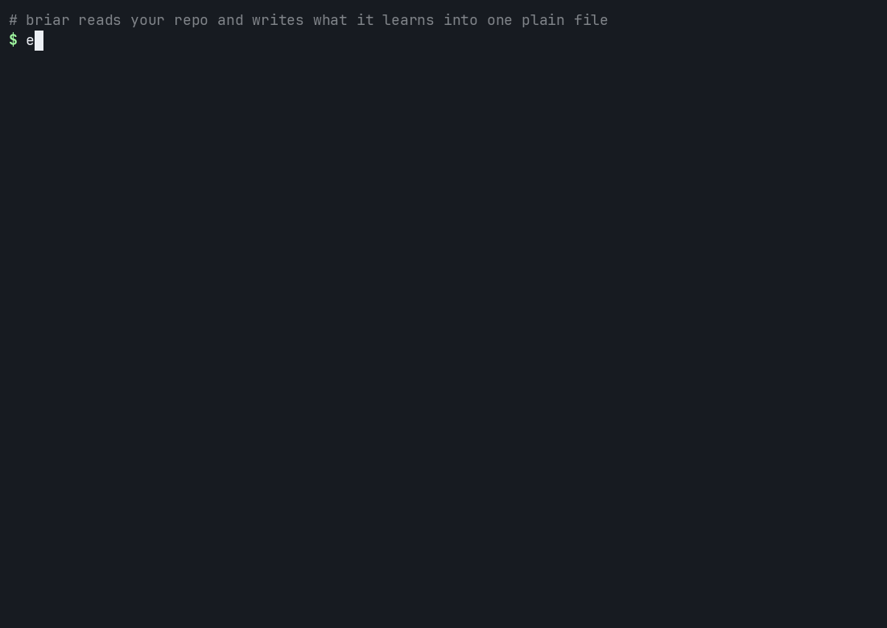
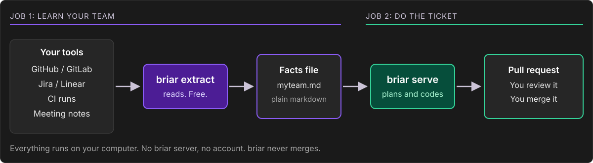
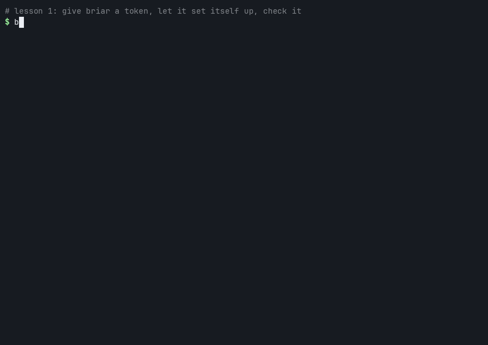
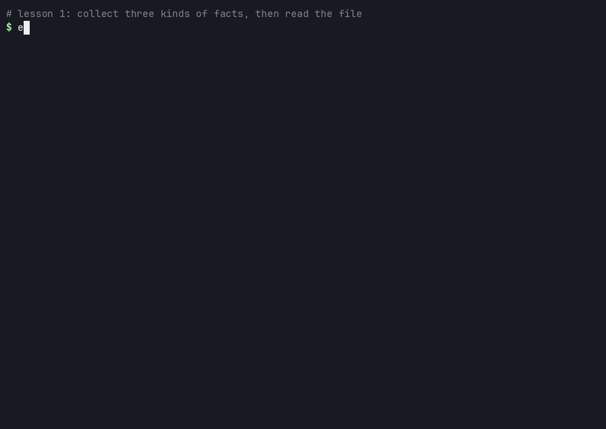
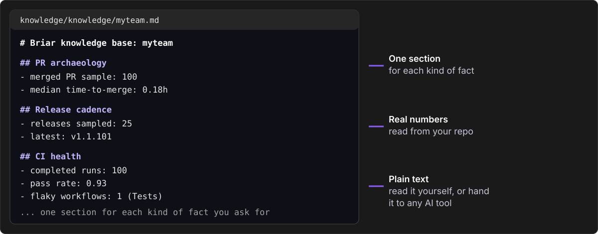
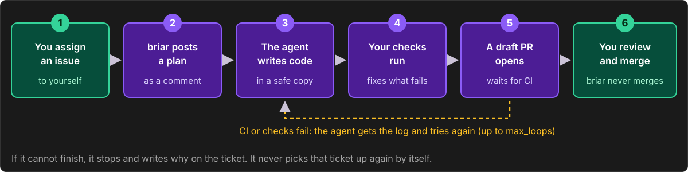
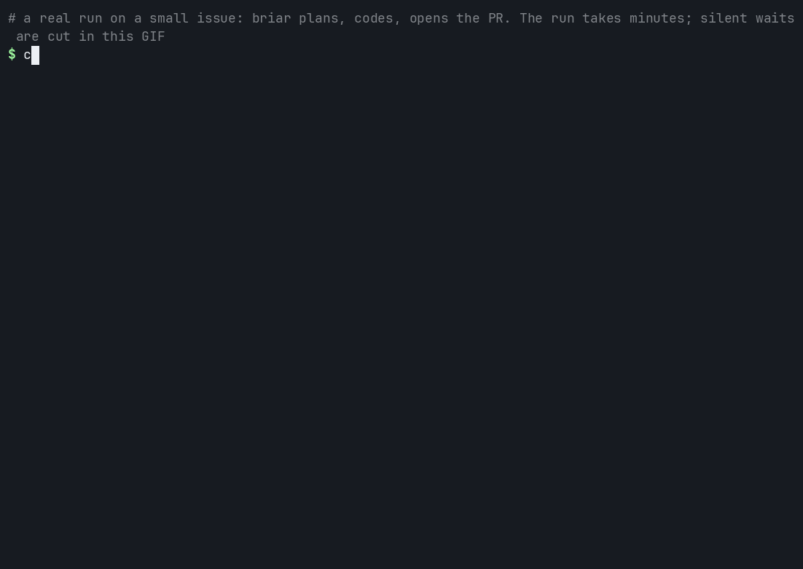
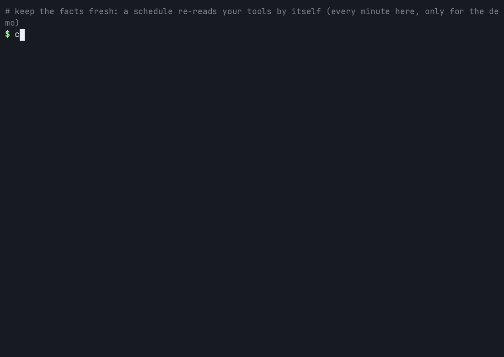

<div align="center">

# briar

**Your repo and your team, written into one plain file. And a helper that turns your tickets into pull requests.**

[](https://pypi.org/project/briar-cli/)
[](https://pypi.org/project/briar-cli/)
[](https://github.com/iklobato/briar/blob/main/LICENSE)

[How it works](#how-it-works) · [Install](#install) · [Lessons](#learn-it-in-4-lessons) · [Commands](#the-4-commands) · [Problems](#when-something-goes-wrong)



</div>

## How it works

briar runs in your terminal. It has two jobs. You can use one without the other.



| I want to... | Run | It costs |
|---|---|---|
| See facts about my repo and team in one file | `briar extract` | Nothing. No AI is used. |
| Have briar do a ticket for me | `briar serve` | AI model money, up to a limit you set. |

**Everything runs on your computer.** There is no briar server and no account. Your tokens stay in a file on your machine. briar never merges: a person does that.

## Install

You need Python 3.10 or later.

```bash
pip install "git+https://github.com/iklobato/briar@v2"
briar --version
```

> **Heads up:** `pip install briar-cli` gives the older 1.x, which has different commands, until 2.0 is on PyPI. The Docker image is also 1.x until then.

Other ways: `pip install 'briar-cli[all]'` (adds GCP and Azure) or `docker run --rm iklob1/briar --version`.

## Learn it in 4 lessons

Each lesson has the real commands and a short video. [Open the guide](https://github.com/iklobato/briar/blob/v2/docs/guide/README.md).

### Lesson 1. Learn your repo (5 minutes, free)

You need `gh` logged in, or a GitHub token. `myteam` is only a label you pick.

```bash
export BRIAR_MYTEAM_GITHUB_TOKEN=$(gh auth token)
cd path/to/your-repo
briar init --company myteam
briar doctor
```



`init` writes your settings. `doctor` checks them. `ok` means ready.

```bash
briar extract --include pr-archaeology --include release-cadence --include ci-health
cat ./knowledge/knowledge/myteam.md
```



You now have a plain markdown file of facts about your repo: merged pull requests, releases and CI health.



[Full lesson 1](https://github.com/iklobato/briar/blob/v2/docs/guide/1-learn-your-repo.md), with the token steps, Jira and what to try next.

### Lesson 2. Let briar do an issue (15 minutes, costs a few cents)

You need a repo where you can push and where CI passes on a pull request. Give briar a GitHub token that can write (Contents, Pull requests, Issues) and a Claude login. Then make a tiny issue and assign it to yourself:

```bash
printf 'BRIAR_MYTEAM_GITHUB_TOKEN=%s\nANTHROPIC_API_KEY=%s\n' \
    "<GitHub token with write access>" "<Claude API key>" >> ~/.config/briar/secrets.env
gh issue create --assignee @me --title "Fix the typo in the README" --body "The word receive is spelled recieve in the install section."
```

Tell briar what it may do in `runbooks/myteam.yaml`. Use your own repo, issue number and test command:

```yaml
version: 1
companies:
  myteam:
    serve:
      repos: [acme-co/acme-app]          # where briar may work
      only: [acme-co/acme-app#12]        # first run: this one issue only
      model: claude-sonnet-5-5
      max_usd: 5                         # most it may spend on one issue
      max_loops: 3                       # most fix attempts
      ci_wait_minutes: 30                # how long it waits for your CI
      max_review_rounds: 3               # most review rounds on one PR
      max_new_per_day: 1                 # new issues it may start per day
      verify: ["pytest -q"]              # the check it runs before it opens a PR
```

```bash
briar doctor --runbooks runbooks    # checks everything. Starts nothing.
briar serve runbooks                # starts. Press Ctrl+C to stop.
```





*A real run on a tiny repo, [iklobato/briar-demo](https://github.com/iklobato/briar-demo): about a minute and a half, US$ 0.09.*

You get a pull request for a person to review and merge. briar never merges, never force pushes and never spends more than the `max_usd` you set. [Full lesson 2](https://github.com/iklobato/briar/blob/v2/docs/guide/2-work-an-issue.md) has the logins, the runbook and the limits.

### Lesson 3. Keep the facts fresh (5 minutes, free)

Put a schedule in a runbook (`runbooks/myteam.yaml`) and `briar serve runbooks` refreshes the facts file for you:

```yaml
version: 1
companies:
  myteam:
    schedules:
      - task: extractors
        every: "day at 03:17"
        extract:
          - name: ci-health
            args: {cihealth_repo: [acme-co/acme-app]}
```



[Full lesson 3](https://github.com/iklobato/briar/blob/v2/docs/guide/3-keep-facts-fresh.md).

### Lesson 4. Let it run alone (10 minutes)

Set a daily limit, read the daily report, and keep `serve` running when you close the terminal.

```yaml
      max_new_per_day: 3        # new issues it may start per day
      max_usd_per_day: 10       # when the day cost reaches this, no NEW issue starts
```

Every poll, briar rewrites `./knowledge/reports/YYYY-MM-DD.md`: what waits for a merge, what stopped and why, and what the day cost. [Full lesson 4](https://github.com/iklobato/briar/blob/v2/docs/guide/4-run-it-alone.md).

## The 4 commands

| Command | What it does | Manual |
|---|---|---|
| `briar init` | Writes your settings and an example runbook. | [setup.md](https://github.com/iklobato/briar/blob/v2/agents/setup.md) |
| `briar doctor` | Shows your settings and checks that everything is ready. | [setup.md](https://github.com/iklobato/briar/blob/v2/agents/setup.md) |
| `briar extract` | Reads your tools and writes the facts file. | [extract.md](https://github.com/iklobato/briar/blob/v2/agents/extract.md) |
| `briar serve` | Works your assigned tickets, and runs your schedules. | [serve.md](https://github.com/iklobato/briar/blob/v2/agents/serve.md) |

Settings, login names and every flag: [reference](https://github.com/iklobato/briar/blob/v2/docs/guide/reference.md).

## When something goes wrong

Run `briar doctor` first. It names what is wrong and how to fix it.

| You see | Do this |
|---|---|
| `the login check failed` | The line below names the missing variable. Set it in `secrets.env`. |
| `HTTP 401` or `Bad credentials` | The token is wrong or expired. Make a new one. |
| `no agent sandbox: install ...` | On Linux, install `bubblewrap` and `socat`. macOS has one. |
| An issue ends `blocked` | Read the comment that starts `briar stopped:`. It says why. |

More errors and the words briar uses: [problems and words](https://github.com/iklobato/briar/blob/v2/docs/guide/problems.md).

## Telemetry

briar sends nothing by default. To help fix bugs you can turn on error reports with `telemetry = "errors-only"` in `.briar.toml`. `DO_NOT_TRACK=1` turns it off whatever else says. Even when it is on, no prompts, file contents, ticket keys, repo names, paths or secrets leave your machine. Details in the [reference](https://github.com/iklobato/briar/blob/v2/docs/guide/reference.md).

## Contributing

Bug reports and pull requests are welcome. Open an [issue](https://github.com/iklobato/briar/issues) or read [CONTRIBUTING.md](https://github.com/iklobato/briar/blob/main/CONTRIBUTING.md). [CHANGELOG.md](https://github.com/iklobato/briar/blob/main/CHANGELOG.md) lists what each version changed. If briar helps you, a star on GitHub helps other people find it.

## License

MIT. See [LICENSE](https://github.com/iklobato/briar/blob/main/LICENSE).
