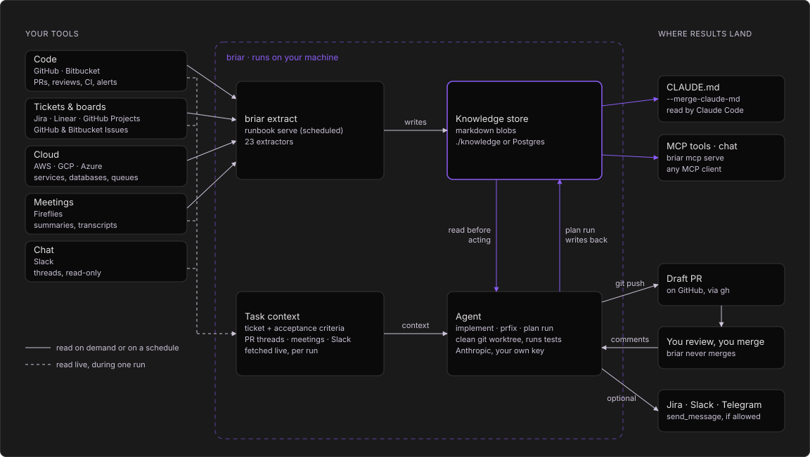
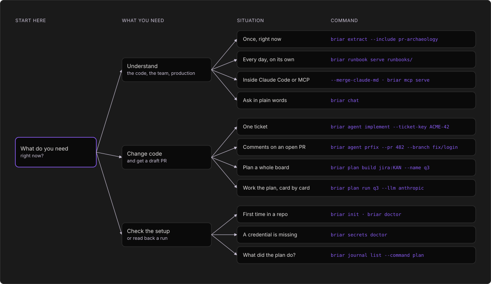

<div align="center">

# briar

**The local CLI that turns your team's tools into knowledge, then runs
coding agents that open draft PRs with it.**

[](https://pypi.org/project/briar-cli/)
[](https://pypi.org/project/briar-cli/)
[](https://pypi.org/project/briar-cli/)
[](https://hub.docker.com/r/iklob1/briar)
[](https://github.com/iklobato/briar/actions/workflows/tests.yml)
[](https://github.com/iklobato/briar/blob/main/LICENSE)

[Install](#install) · [Quickstart](#quickstart) · [Docs](https://usebriar.com/docs) · [Website](https://usebriar.com) · [Changelog](https://github.com/iklobato/briar/blob/main/CHANGELOG.md)


New to briar? [Learn it in 2 examples](#learn-briar-in-2-examples), from install to a schedule.

</div>

briar is a command-line tool (you run it in your terminal) that helps AI
coding assistants do better work on your team's code.

**The problem:** an AI assistant like Claude can write code, but it does
not know your team. It does not know which tests you run, who reviews what,
how your PRs usually look, or what the ticket really asks. So it guesses,
and you fix its guesses.

**What briar does about it**, in two parts:

1. **It collects facts.** It reads your team's tools (GitHub or Bitbucket,
   Jira or Linear, AWS, Fireflies meeting notes) and writes what it learns
   into plain text files on your computer. briar calls these facts
   "knowledge".
2. **It gives those facts to AI agents.** An agent is an AI that works on
   its own, step by step. One briar agent takes a ticket and opens a draft
   PR (a PR marked "not ready to merge yet"). Another one fixes the review
   comments on a PR. You always review and merge yourself.

There is no briar server and no account. briar only talks to the services
you set up: your code host, your tracker, your cloud and your AI provider.
Your tokens stay in a file on your computer.

## What you get

- **Facts from your tools.** briar has 23 extractors. An extractor is a
  small reader for one kind of fact, for example "how long PRs take to
  merge" or "which files change the most". They read GitHub, Bitbucket,
  Jira, Linear, AWS, GCP, Azure and Fireflies, and write plain markdown text
  to a folder, once or on a schedule.
- **AI agents that read the facts first.** `briar agent implement` takes a
  ticket, reads the facts it needs, writes the code in a fresh copy of your
  repo, runs your tests and opens a draft PR. `briar agent prfix` answers
  each review comment with its own small commit. Agents never force-push,
  amend or rebase, so they never rewrite history that is already there.
- **A whole board, one card at a time.** `briar plan` reads a Jira board or
  a GitHub Project (the list of tickets your team works on), puts the cards
  in order and works on them one by one. When a card needs another card's
  code, it starts from that card's branch, so the PRs build on each other.
- **You stay in charge.** Agents only open draft PRs. briar has no command
  that merges.
- **Works with your other AI tools.** The facts are one markdown file
  that Claude Code or any other agent can read.
- **Runs on your computer.** No account. Keys stay in a file on your
  machine.

## Where the knowledge comes from, and where the work goes



Everything in the dashed box runs on your machine and reads from your
tools. Agents push branches, open draft PRs and reply on reviews; their
`send_message` tool only reaches the channels you list in the runbook.

1. Extractors read your tools, on demand or on a schedule, and write
   markdown knowledge to a local folder.
2. You point an agent at a ticket or a PR. It fetches the ticket, the PR's
   review threads, and matching meeting notes and Slack messages live.
3. In a clean git worktree it first reads the knowledge sections that fit
   its job (conventions, hotspots, reviewers, PR history), writes the code
   on a new branch and runs your tests. Coding agents run on Anthropic with
   your own key.
4. It pushes and opens a draft PR. If you allow those channels in the
   runbook, it can also comment on the ticket or post in Slack or Telegram.
5. You review. `briar agent prfix` answers the comments with one commit per
   thread. You merge; briar never does.
6. A plan run writes what each card taught into the plan's knowledge, which
   its selector reads before the next pick. All knowledge also feeds Claude
   Code (`CLAUDE.md`).

More diagrams are in [See it run](#see-it-run).

## Install

```bash
pip install briar-cli
briar --version
```

briar needs Python 3.10 or later.

The base install covers GitHub, Bitbucket, AWS, Jira, Linear and
Fireflies, and writes to a local folder. Extras add more:

```bash
pip install 'briar-cli[all]'      # gcp, azure
```

Or skip the install and use the Docker image, which also has `git` and
`gh`:

```bash
docker run --rm iklob1/briar --version
```

Mounts and keys in Docker:
[usebriar.com/docs/install#docker](https://usebriar.com/docs/install#docker).
What each extra adds:
[usebriar.com/docs/install#extras](https://usebriar.com/docs/install#extras).

## Quickstart

The short version, for a GitHub repo with Jira tickets. New to briar?
[Learn it in 2 examples](#learn-briar-in-2-examples) instead.

```bash
# 1. Save a GitHub token and Jira login. They go to ~/.config/briar/secrets.env
briar auth login github-pat --company acme
briar auth login jira-token --company acme

# 2. Read the repo's recent PRs and its tools into the blob knowledge:acme
briar extract --company acme --repo acme-co/acme-app \
    --include pr-archaeology --include codebase-conventions

# 3. Read what was saved
cat ./knowledge/knowledge/acme.md
```

After step 2 you have `./knowledge/knowledge/acme.md`.

## Learn briar in 2 examples

Written for someone who has never used briar. Each example says the
problem it solves, what each command does, what happens behind the scenes,
and what you get. Every GIF is a real run in a clone of this repo on briar
1.1.99: the commands really ran; only the typing is paced, and a long
output is shown one screen at a time so you can read it.

**Before you start** (once, about 2 minutes):

```bash
pip install briar-cli                  # installs the briar command (needs Python 3.10 or later)
cd path/to/your-repo                   # go into any GitHub repo you can read
export GITHUB_TOKEN=$(gh auth token)   # gives briar your GitHub login, so it can read the repo
```

If you do not use the GitHub CLI `gh`, run
`briar auth login github-pat --company myteam` and paste a GitHub token
instead. That token is all both examples need. Nothing is sent to an
AI, so they cost nothing.

**Words you will see:**

| Word | What it means |
|---|---|
| extractor | A reader for one kind of fact, like "merged PRs" or "CI runs". |
| knowledge, blob | The facts briar saved. One markdown file, named like `knowledge:myteam`. |
| runbook | A YAML file that lists which extractors to run, for which team, and how often. |

### Example 1: Set up briar and collect facts

**The problem:** an AI that writes code for you does not know your repo or
how your team works: how fast PRs get merged, who writes them, how often
you release, how often CI passes.

```bash
briar init --company myteam    # creates .briar.toml, a small settings file in your repo
briar doctor                   # checks that briar has everything it needs
briar extract --include pr-archaeology --include release-cadence --include ci-health
                               # collects three kinds of facts
cat ./knowledge/knowledge/myteam.md  # prints the facts briar saved
```


**What happens:**

- `init` runs `git remote get-url origin` to find the GitHub owner and repo
  name, and writes them into `.briar.toml` with the team name you chose
  (`myteam` is just a label). After this, no command needs `--company` or
  `--repo`. To see each setting and where it came from, run
  `briar config show`.
- `doctor` checks Python, the settings file, the git remote and your
  GitHub token. `ok` means ready; `warn` tells you what is missing
  and what needs it.
- `extract` runs the extractors you name with `--include`. They ask the
  GitHub API for your merged PRs (`pr-archaeology`), your releases
  (`release-cadence`) and your last 100 CI runs (`ci-health`), and sum
  them up. The result is saved as one markdown file under `./knowledge/`,
  called `knowledge:myteam`.
- Each extractor's limits (how many PRs, how many days) have defaults.
  Change one in `.briar.toml`, for example `[extract.pr-archaeology]`
  then `max = 50`; `briar extract -h` lists every key.
- `cat` prints the saved file. It is a plain markdown file on your disk.
  (The GIF was recorded on 1.x, which also updated `CLAUDE.md` with
  `--merge-claude-md` and read the file with `briar context get`; 2.0
  removed both.)

**You get:** your repo's facts in one text file, ready for any AI.

`briar extract -h` lists all 23 extractors. Good ones to add later:
`code-hotspots` (the files that change the most),
`codebase-conventions` (your test runner, linter and formatter) and
`stale-prs` (open PRs nobody touched for a while). Running `extract` again
only replaces the sections of the extractors that ran, so the facts you
already have stay. `briar extract` with no `--include` runs all 23; on this
repo that took about 4 minutes.

### Example 2: Keep the facts fresh with a runbook

**The problem:** facts from last month are wrong today, and you do not want
to type the extract command every day.

Save this as `runbooks/myteam.yaml`. It lists the same three extractors as
example 1:

```yaml
version: 1
companies:
  myteam:
    schedules:
      - task: extractors
        every: "minute"          # only for the demo; use "day at 03:17" for real
        extract:
          - name: pr-archaeology
            args: {pr_repo: [iklobato/briar]}
          - name: release-cadence
            args: {release_repo: [iklobato/briar]}
          - name: ci-health
            args: {cihealth_repo: [iklobato/briar]}
```

```bash
briar runbook serve runbooks   # start a scheduler for every runbook in the folder
```


**What happens:**

- `serve` is a scheduler: a program that keeps running and starts each job
  on time. Every second it checks which job is due.
- When the job is due, it does the same work as `briar extract` and saves
  `knowledge:myteam` again. The log lines show each step.
- It runs until you press Ctrl+C. On a server you leave it running.
- To run the file once, right now, use `briar runbook extract runbooks/myteam.yaml`.
- More teams go under `companies:`. Each team gets its own file, and their
  first runs start a few seconds apart, so they do not all call GitHub at
  the same moment.
- A runbook writes its whole file each time, so list in it every extractor
  you want to keep.

**You get:** facts that refresh themselves, without anyone typing a
command.

## Commands

Each command has a manual in [`agents/`](https://github.com/iklobato/briar/blob/main/agents/README.md).
The same reference, with more examples, is at
[usebriar.com/docs](https://usebriar.com/docs).

| Command | What it does | Manual |
|---|---|---|
| `briar extract` | Reads your tools into a knowledge blob (23 extractors). | [extract.md](https://github.com/iklobato/briar/blob/main/agents/extract.md) |
| `briar runbook` | Runs extractors from a YAML file, once or on a schedule. | [runbook.md](https://github.com/iklobato/briar/blob/main/agents/runbook.md) |
| `briar auth` | Saves credentials (`login`, `logout`, `list`, `status`, `refresh`). | [auth.md](https://github.com/iklobato/briar/blob/main/agents/auth.md) |
| `briar init`, `config show`, `doctor`, `--install-completion` | Setup helpers, and how to turn on telemetry. | [setup.md](https://github.com/iklobato/briar/blob/main/agents/setup.md) |

`briar scaffold`, `briar dashboard`, `briar mcp serve`, `briar chat`,
`briar agent`, `briar plan`, `briar context`, `briar secrets`,
`briar journal`, `briar telemetry` and `briar version` were removed in
2.0 (`briar --version` stays). They are still in briar 1.x:
`pip install 'briar-cli<2'`. The MCP registry entry
`io.github.iklobato/briar` stays on 1.x (1.1.94).

Recipes that chain these commands are in
[flows.md](https://github.com/iklobato/briar/blob/main/agents/flows.md). A
runbook that uses every feature is
[examples/all_features.yaml](https://github.com/iklobato/briar/blob/main/examples/all_features.yaml).

Three flags work with every command, anywhere on the line:

| Flag | What it does |
|---|---|
| `--format table\|json` | Output shape. Lists default to `table`, single records to `json`. |
| `--verbose`, `-v` | Debug logs on stderr. |
| `--version`, `-V` | Print the version and exit. |

## See it run

The first diagram from [usebriar.com](https://usebriar.com/#diagrams). Click it to open it.

<details>
<summary><b>Which command?</b></summary>



1. Want to know something about the code, the team or production? Read it
   once with `briar extract`, or every day with `runbook serve`.
2. Setting up or checking? `briar init` and `briar doctor` first, and
   `briar auth status` when a credential is missing.

</details>


## Contributing

Bug reports and PRs are welcome: open an
[issue](https://github.com/iklobato/briar/issues) or read
[CONTRIBUTING.md](https://github.com/iklobato/briar/blob/main/CONTRIBUTING.md)
first. Every merge to `main` is a release on PyPI and Docker Hub, and
[CHANGELOG.md](https://github.com/iklobato/briar/blob/main/CHANGELOG.md)
lists what each version changed. If briar helps you, a star on GitHub
helps other people find it.

## Telemetry

briar sends nothing by default. To help fix bugs, turn on error reports
with `telemetry = "errors-only"` in `.briar.toml` (or
`BRIAR_TELEMETRY=errors-only`), or error reports and usage counts with
`full`. `DO_NOT_TRACK=1` turns it off whatever else says. Even then, no
prompts, file contents, ticket keys, repo names, paths or secret values
leave your machine. 1.x sent by default; 2.0 ignores the choice 1.x
saved, so turn it on again if you want it.

## License

MIT. See [LICENSE](https://github.com/iklobato/briar/blob/main/LICENSE).
