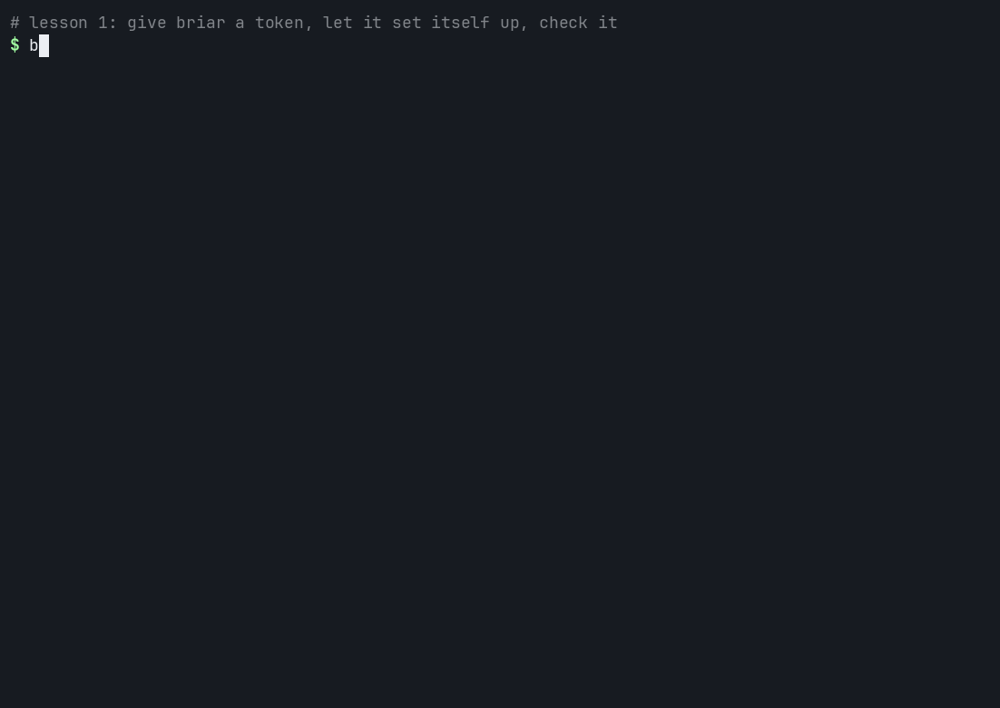
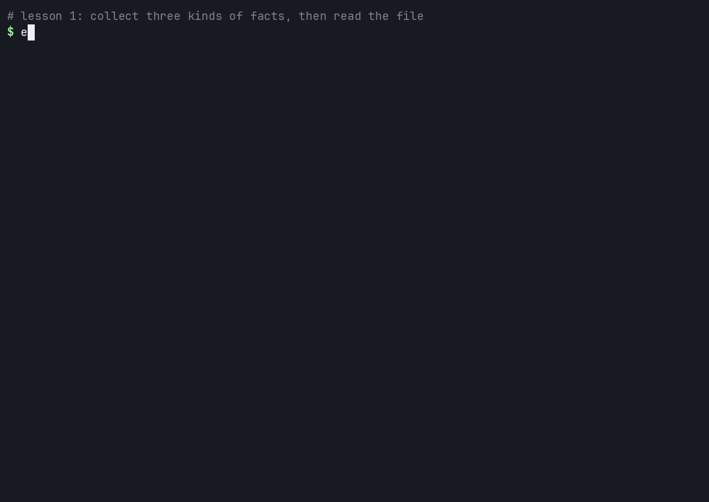
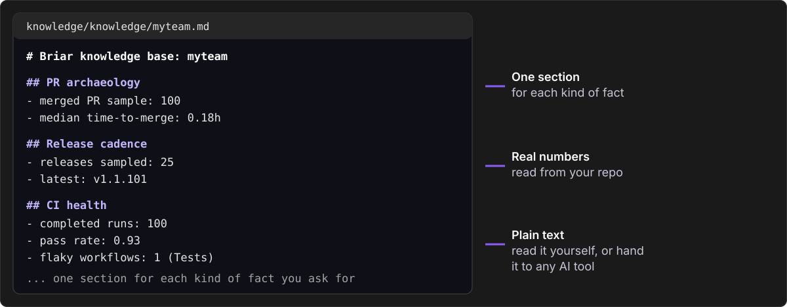

# Lesson 1: Learn your repo

**You will:** set briar up and make a file of facts about a repo.
**Time:** about 5 minutes. **Cost:** nothing. No AI is used.

**You need:**
- A terminal and Python 3.10 or later.
- A GitHub account. A repo you can read.
- The GitHub CLI `gh`, logged in (easiest). Or a GitHub token. Step 2 shows both.

## Step 1. Install briar

```bash
pip install "git+https://github.com/iklobato/briar@v2"
briar --version
```

You should see a version that starts with `2.`. (When 2.0 is on PyPI, `pip install briar-cli` is enough.)

## Step 2. Give briar a token

briar needs to read your repo. It looks for a token in an environment variable. `myteam` is only a label: you pick it.

With `gh`:

```bash
export BRIAR_MYTEAM_GITHUB_TOKEN=$(gh auth token)
```

Without `gh`, [create a token](https://github.com/settings/personal-access-tokens/new) (read access is enough) and keep it in a file only you can read:

```bash
mkdir -p ~/.config/briar && chmod 700 ~/.config/briar
printf 'BRIAR_MYTEAM_GITHUB_TOKEN=%s\n' "<your token>" >> ~/.config/briar/secrets.env
chmod 600 ~/.config/briar/secrets.env
```

## Step 3. Let briar set itself up, then check it

Go into a repo and run two commands.

```bash
cd path/to/your-repo
briar init --company myteam
briar doctor
```



**What happened**
- `init` read your `git remote` to find the owner and the repo. It wrote `.briar.toml` (your settings) and `runbooks/myteam.yaml` (an example, used in lesson 2).
- `doctor` printed your settings and checked every login, live.
- `ok` means ready. `fail` tells you what to fix. `warn` means briar could not reach the source.

## Step 4. Collect facts

```bash
briar extract --include pr-archaeology --include release-cadence --include ci-health
```



**What happened**
- `pr-archaeology` read your merged pull requests.
- `release-cadence` read your releases.
- `ci-health` read your last 100 CI runs.
- briar wrote everything into one file.

## Step 5. Read the file

```bash
cat ./knowledge/knowledge/myteam.md
```



It is a plain markdown file on your disk. Read it yourself, or give it to any AI tool.

## You did it

You now have a file of facts about your repo. Run `extract` again any time: it only replaces the sections of the readers that ran.

**Try next**
- `briar extract -h` lists all 24 readers (briar calls them extractors).
- `code-hotspots`: the files that change the most.
- `codebase-conventions`: your test runner, linter and formatter.
- `stale-prs`: open pull requests that nobody touched for a while.
- `briar extract` with no `--include` runs all 24. It takes a few minutes.

### With Jira too

Add your Jira site and a Jira login next to the GitHub token:

```bash
printf 'company = "acme"\n[auth.jira]\nsite = "acme.atlassian.net"\n[extract.active-tickets]\ntracker = "jira"\nprojects = ["ACME"]\n' >> .briar.toml
printf 'BRIAR_ACME_JIRA_EMAIL=%s\nBRIAR_ACME_JIRA_TOKEN=%s\n' \
    "<Atlassian email>" "<Atlassian API token>" >> ~/.config/briar/secrets.env
briar doctor          # checks both logins, live
briar extract --company acme --repo acme-co/acme-app --include active-tickets
```

## If it fails

| You see | Do this |
|---|---|
| `the login check failed` | The line below it names the missing variable. Set it, then run `briar doctor` again. |
| `HTTP 401` or `Bad credentials` | The token is wrong or expired. Make a new one. |
| `pr-archaeology: no data` | The repo has no merged pull requests yet. Try another repo. |

More: [problems and words](problems.md).

**Next:** [Lesson 2. Let briar do an issue](2-work-an-issue.md)
