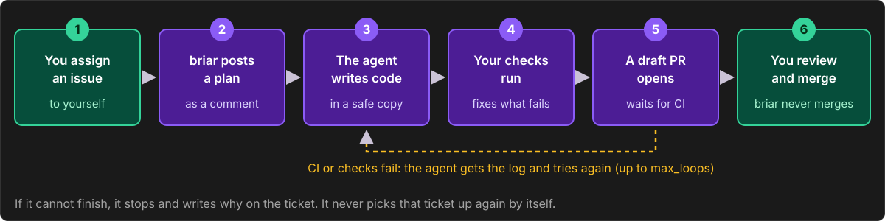
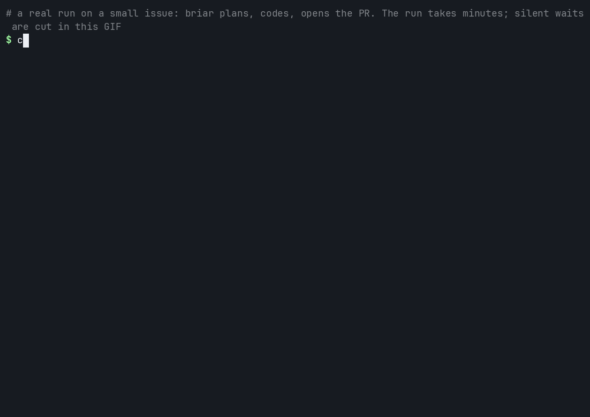

# Lesson 2: Let briar do an issue

**You will:** give briar one small issue and get a pull request (PR) that a person can review.
**Time:** about 15 minutes. **Cost:** real money for the AI model. In our tests a small issue cost US$ 0.08 to US$ 0.25. You set a limit.
**You need:** lesson 1 done, and a repo where **you can push** and where **CI passes** on a pull request.

briar opens a real PR in your repo. You can close it after.



## Step 1. Give briar two logins

- A GitHub token that can **write**: read and write on Contents, Pull requests and Issues.
- A Claude login: `ANTHROPIC_API_KEY` or `CLAUDE_CODE_OAUTH_TOKEN`.

```bash
printf 'BRIAR_MYTEAM_GITHUB_TOKEN=%s\nANTHROPIC_API_KEY=%s\n' \
    "<GitHub token with write access>" "<Claude API key>" >> ~/.config/briar/secrets.env
```

`serve` also needs a sandbox, a locked box for the agent. macOS has one. On Linux, install `bubblewrap` and `socat`.

## Step 2. Make a tiny issue and assign it to yourself

`serve` only takes issues assigned to the owner of the token. Pick something small, like one sentence in a doc.

```bash
gh issue create --assignee @me --title "Fix the typo in the README" --body "The word receive is spelled recieve in the install section."
```

Write down the number it prints, for example `12`.

## Step 3. Write a small runbook

A runbook is a YAML file that tells briar what it may do. Replace `runbooks/myteam.yaml` with this. Use your own repo, issue number and test command.

```yaml
version: 1
companies:
  myteam:
    serve:
      repos: [acme-co/acme-app]          # where briar may work
      only: [acme-co/acme-app#12]        # first run: touch this one issue only
      model: claude-sonnet-5-5
      max_usd: 5                         # most it may spend on one issue
      max_loops: 3                       # most fix attempts on one issue
      ci_wait_minutes: 30                # how long it waits for your CI
      max_review_rounds: 3               # most review rounds on one PR
      max_new_per_day: 1                 # new issues it may start per day
      verify: ["pytest -q"]              # the check it runs before it opens a PR
```

`verify` is how briar knows the change works. Use your own test command. briar does not guess how much money to spend, so the limits have no default.

## Step 4. Check, then start

```bash
briar doctor --runbooks runbooks     # checks the runbook, the logins and the sandbox. Starts nothing.
briar serve runbooks                 # starts watching
```



*A real run on a tiny repo, [iklobato/briar-demo](https://github.com/iklobato/briar-demo). It took about a minute and a half and cost US$ 0.09. The waits with no output are cut in the video.*

## What you will see

The log has a line for every GitHub call. These lines tell the story (`briar serve runbooks 2>&1 | grep serve:` shows only them):

```text
serve: myteam: picked acme-co/acme-app#12 for acme-co/acme-app: <why it picked it>
serve: issue-12 is planned
serve: issue-12 is pr-open https://github.com/acme-co/acme-app/pull/13
serve: issue-12 is done https://github.com/acme-co/acme-app/pull/13 US$ 0.15 of 5.0, 0 of 3 fix loops
```

## What happened

1. briar asked the agent for a plan and posted it as a comment on the issue.
2. It made a branch `briar/issue-12` in its own copy of your repo. Your own files are never touched.
3. The agent wrote the change. briar ran `verify`. If a check failed, the agent fixed it, up to `max_loops` times.
4. briar pushed the branch and opened a **draft** PR that says `Closes #12`.
5. It waited for your CI. If CI failed, the agent got the failed log and fixed it.
6. When CI passed, briar marked the PR **ready** and asked the two people who usually review that repo.
7. If someone comments, briar reads it, changes the code or says why not, and replies in the thread.

## Stop it

`serve` runs until you press **Ctrl+C**. It looks for new work every 5 minutes (`poll_minutes`), so a quiet log is normal. Run only one `serve` per runbook folder.

## What briar never does

- It never merges.
- It never force pushes.
- It never spends more than `max_usd` on one issue.
- If it cannot finish, it stops, writes why on the issue (and on the draft PR), and does not pick that issue up again by itself.

## If it fails

| You see | Do this |
|---|---|
| `no agent sandbox: install ...` | On Linux, install `bubblewrap` and `socat`. |
| `no model login` | Set `ANTHROPIC_API_KEY` or `CLAUDE_CODE_OAUTH_TOKEN`. |
| `Field required` | Fill in `model`, `max_usd`, `max_loops`, `ci_wait_minutes`, `max_review_rounds`. |
| The issue ends `blocked` | Read the comment that starts `briar stopped:`. Often your `verify` command fails even without briar, or CI was already red. Fix that first. |

More: [problems and words](problems.md).

**Next:** [Lesson 3. Keep the facts fresh](3-keep-facts-fresh.md)
