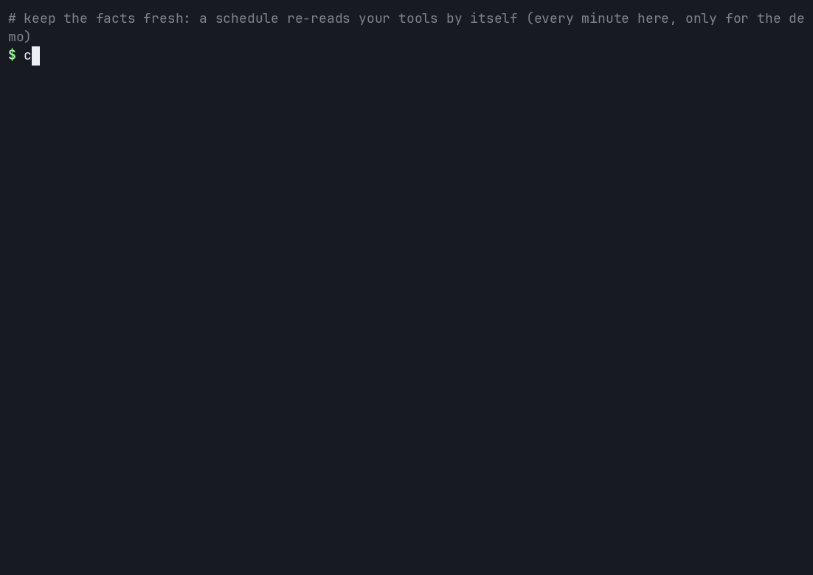

# Lesson 3: Keep the facts fresh

**You will:** make briar refresh your facts file by itself, so nobody has to type `extract`.
**Time:** about 5 minutes. **Cost:** nothing. No AI is used.
**You need:** lesson 1 done.

## Step 1. Write a runbook with a schedule

A runbook with no `serve:` block only runs its schedules. Put this in `runbooks/myteam.yaml`, with your own repo:

```yaml
version: 1
companies:
  myteam:
    schedules:
      - task: extractors
        every: "day at 03:17"
        extract:
          - name: pr-archaeology
            args: {pr_repo: [acme-co/acme-app]}
          - name: release-cadence
            args: {release_repo: [acme-co/acme-app]}
          - name: ci-health
            args: {cihealth_repo: [acme-co/acme-app]}
```

A schedule writes the whole file each time. List every reader you want to keep.

## Step 2. Check, then start

```bash
briar doctor --runbooks runbooks   # checks the runbook and its logins. Starts nothing.
briar serve runbooks               # runs until you press Ctrl+C
```



*The video uses `every: "minute"` so you can see two runs. Use a slower time in real life.*

**What happened**
- At each time you set, briar ran the three readers again.
- It rewrote `knowledge/knowledge/myteam.md` with fresh numbers.
- It kept running until Ctrl+C.

For a quick test use `every: "minute"`. Set it back after.

**Next:** [Lesson 4. Let it run alone](4-run-it-alone.md)
