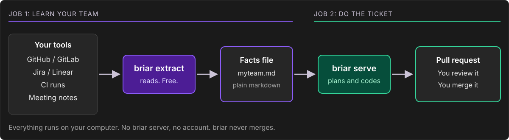

# Learn briar, one lesson at a time

briar is a program for your terminal. It does two jobs. Each lesson teaches one thing, with the real commands and a short video.

| Lesson | You learn | Time | Cost |
|---|---|---|---|
| [1. Learn your repo](1-learn-your-repo.md) | Set briar up and collect facts about a repo | 5 minutes | Nothing |
| [2. Let briar do an issue](2-work-an-issue.md) | Hand one small issue to briar and get a pull request | 15 minutes | A few cents of AI model |
| [3. Keep the facts fresh](3-keep-facts-fresh.md) | Refresh the facts file by itself, on a schedule | 5 minutes | Nothing |
| [4. Let it run alone](4-run-it-alone.md) | Set limits, read the daily report, keep it running | 10 minutes | You set the limit |

Start with lesson 1. Lessons 2 to 4 need lesson 1.

Need a command, a setting or a login name? See the [reference](reference.md).
Something broke? See [problems and words](problems.md).
